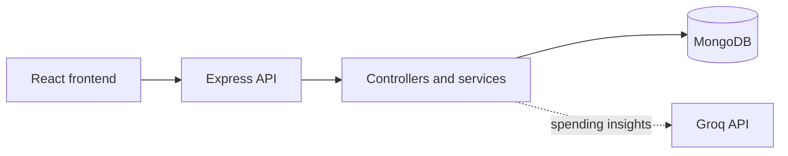

# SpendWise

> **Your money, made clearer.**

SpendWise is a full-stack personal finance application for tracking income and
expenses, planning monthly budgets, and understanding spending patterns. It
also helps users share group expenses, calculate balances, and record
settlements in one workspace.

## Features

- Track income and expenses with categories, dates, descriptions, and CRUD
  management.
- Create monthly category budgets and monitor spending progress.
- View dashboard analytics for monthly totals, category breakdowns, and budget
  usage.
- Share group expenses using equal, exact, or percentage-based splits.
- Calculate net balances, suggest settlements, and keep settlement history.
- Generate optional spending insights with aggregated data through Groq.
- Authenticate with JWT and bcrypt, with profile and password management.

## Tech stack

- **Frontend:** React, TypeScript, Vite, React Router, Axios, Recharts
- **Backend:** Node.js, Express, TypeScript, Zod
- **Database:** MongoDB with Mongoose
- **AI integration:** Groq SDK with a configurable chat-completion model
- **Supporting libraries:** Helmet, CORS, dotenv, Vitest, Supertest

## Architecture

The React frontend calls authenticated Express routes. Controllers validate
requests and delegate to services for finance calculations, budgets, groups,
settlements, and insights. Mongoose models persist user-owned data in MongoDB;
the insights service sends aggregated analytics and budget context to Groq.



## Getting started

### Prerequisites

- Node.js and npm
- MongoDB, either local or MongoDB Atlas
- A Groq API key if spending insights are required

### Install

```powershell
git clone https://github.com/yashjethva01/spendwise.git
cd spendwise

cd server
npm install
Copy-Item .env.example .env

cd ..\client
npm install
Copy-Item .env.example .env
```

Configure `server/.env` using the provided template:

```env
PORT=5000
CLIENT_URL=http://localhost:5173
MONGODB_URI=your_mongodb_connection_string
JWT_SECRET=your_long_random_secret_at_least_32_characters
GROQ_API_KEY=your_groq_api_key_here
GROQ_MODEL=openai/gpt-oss-120b
```

`MONGODB_URI` and `JWT_SECRET` are required. `GROQ_API_KEY` is optional for
core finance features and required for AI insights. Configure the client
template with `VITE_API_URL=http://localhost:5000/api`. Never commit real
credentials or secrets.

Start each application in a separate terminal:

```powershell
# Backend
cd server
npm run dev

# Frontend
cd client
npm run dev
```

Open `http://localhost:5173`.

## Useful scripts

| Area | Commands |
| --- | --- |
| Backend | `npm test`, `npm run typecheck`, `npm run build`, `npm start` |
| Frontend | `npm run typecheck`, `npm run build`, `npm run lint`, `npm run preview` |

## Project structure

```text
SpendWise/
├── client/src/              # React pages, components, API clients, and types
├── server/src/
│   ├── controllers/         # HTTP handlers
│   ├── models/              # Mongoose schemas
│   ├── routes/              # Express route modules
│   └── services/            # Business logic and Groq integration
├── server/tests/            # Backend tests
└── docs/                    # Design documentation
```
