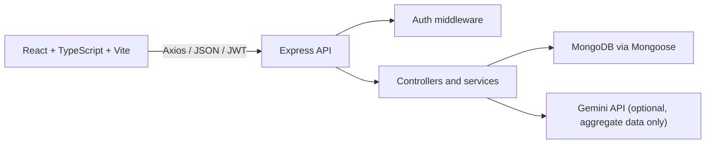

# SpendWise Pro

SpendWise Pro is a single-application expense analytics and budget assistant
built as a portfolio project. It supports authenticated users, personal
transactions, monthly budgets, server-calculated analytics, and an optional
Gemini-powered spending summary.

## Implemented features

- User registration, login, JWT authentication, and protected routes
- Password hashing with bcryptjs
- Transaction create, list, filter, pagination, retrieve, update, and delete
- Per-user transaction ownership enforcement
- Monthly income, expense, net-savings, and category-spending analytics
- Monthly category budgets with duplicate prevention and backend-calculated usage
- Responsive React dashboard with Recharts
- Transaction and budget management screens
- Optional Gemini spending assistant using aggregate financial data only
- Centralized validation and API error responses
- Health endpoint with database status

The Gemini assistant is advisory text only. It is not the source of truth for
financial calculations and is not financial advice.

## Architecture

This is a modular monolith with separate frontend and backend applications:



Backend request flow:

```text
HTTP request
  -> Express middleware (Helmet, CORS, JSON parsing)
  -> route
  -> authentication and Zod validation
  -> controller
  -> service
  -> Mongoose model / analytics aggregation
  -> consistent JSON response
```

The backend never trusts a client-supplied user ID. Authenticated ownership
comes from the verified JWT subject and is included in every user-owned query.

## Technology stack

- Frontend: React 19, TypeScript, Vite, React Router, Axios, responsive CSS,
  Recharts
- Backend: Node.js, Express 5, TypeScript
- Database: MongoDB with Mongoose
- Authentication: JWT and bcryptjs
- Validation: Zod
- AI: Gemini REST API, called only by the backend
- Testing: Vitest and Supertest

## Prerequisites

- Node.js 20 or newer
- npm
- MongoDB Atlas account and database, or a local MongoDB server
- A Gemini API key only if the spending assistant is needed

## Local setup

### 1. Install dependencies

```powershell
cd server
npm install

cd ..\client
npm install
```

### 2. Configure the backend

Copy `server/.env.example` to `server/.env` and set:

```env
PORT=5000
CLIENT_URL=http://localhost:5173
MONGODB_URI=your_mongodb_connection_string
JWT_SECRET=your_long_random_secret_at_least_32_characters
GEMINI_API_KEY=your_gemini_api_key
GEMINI_MODEL=gemini-3.8-flash
```

`GEMINI_API_KEY` is optional for the core application. Leave it as the example
placeholder to disable the assistant. The MongoDB URI, JWT secret, and Gemini
key are private values: do not paste them into source files, screenshots, or
Git commits.

### 3. Configure the frontend

Copy `client/.env.example` to `client/.env`:

```env
VITE_API_URL=http://localhost:5000/api
```

Only the API URL belongs in frontend environment variables. Never put JWT
secrets, MongoDB credentials, or Gemini keys in `client/.env`.

### 4. Start the applications

In one terminal:

```powershell
cd server
npm run dev
```

In another terminal:

```powershell
cd client
npm run dev
```

Open the Vite URL shown in the terminal, normally
`http://localhost:5173`.

### 5. Verify the backend

```powershell
Invoke-WebRequest http://localhost:5000/api/health
```

With MongoDB connected, the response should report `"status":"ok"` and
`"database":"connected"`. If the database is unavailable, startup fails or
the health response reports a degraded database state.

## Database setup

For MongoDB Atlas:

1. Create an Atlas project and cluster.
2. Create a database user with a strong password.
3. Add your development IP address under Network Access.
4. Choose **Connect > Drivers**, copy the Node.js connection string, and put it
   in `server/.env` as `MONGODB_URI`.
5. Replace the password placeholder and URL-encode special characters in it.

The application creates its collections through Mongoose when data is first
written. Budget and transaction indexes are defined by their schemas.

## Commands

Backend:

```powershell
cd server
npm run typecheck
npm run build
npm test
npm start
```

Frontend:

```powershell
cd client
npm run typecheck
npm run build
npm run lint
npm run preview
```

The backend tests use mocked model/provider boundaries, so they do not require
a live MongoDB or Gemini account. Browser-level frontend tests are not currently
configured.

## Main API endpoints

All protected endpoints require:

```http
Authorization: Bearer <jwt>
```

- `GET /api/health`
- `POST /api/auth/register`
- `POST /api/auth/login`
- `GET /api/auth/me`
- `GET /api/transactions`
- `POST /api/transactions`
- `GET /api/transactions/:id`
- `PATCH /api/transactions/:id`
- `DELETE /api/transactions/:id`
- `GET /api/budgets?year=YYYY&month=M`
- `POST /api/budgets`
- `PATCH /api/budgets/:id`
- `DELETE /api/budgets/:id`
- `GET /api/analytics/monthly?year=YYYY&month=M`
- `POST /api/insights/spending-summary`

Request and response examples are available in
[server/API.md](./server/API.md).

## Deployment

The frontend and backend can be deployed separately.

### Backend

1. Create a Node.js service whose root directory is `server`.
2. Install with `npm ci`.
3. Build with `npm run build`.
4. Start with `npm start`.
5. Configure `PORT` using the host-provided port when required.
6. Set `MONGODB_URI`, `JWT_SECRET`, and `CLIENT_URL`.
7. Set `GEMINI_API_KEY` and `GEMINI_MODEL` only when the assistant is enabled.

`CLIENT_URL` must be the exact deployed frontend origin, including scheme and
port when applicable. Do not use `*` for the production CORS origin.

### Frontend

1. Create a static hosting project whose root directory is `client`.
2. Install with `npm ci`.
3. Build with `npm run build`.
4. Publish the generated `client/dist` directory.
5. Set `VITE_API_URL` to the deployed backend URL ending in `/api` before build.

If the frontend and backend use different domains, configure the backend
`CLIENT_URL` to match the frontend domain and confirm that the deployment
platform forwards HTTPS requests correctly.

## Screenshots

Add real screenshots here before presenting the project:

- `[Screenshot: login screen](./docs/screenshots/login.png)`
- `[Screenshot: dashboard](./docs/screenshots/dashboard.png)`
- `[Screenshot: transactions](./docs/screenshots/transactions.png)`
- `[Screenshot: budgets](./docs/screenshots/budgets.png)`
- `[Screenshot: spending assistant](./docs/screenshots/assistant.png)`

These are placeholders only; the referenced files are not currently included.

## Known limitations and future improvements

- JWTs are stored in browser `localStorage` for this MVP. An XSS vulnerability
  could expose the token; production hardening could use secure, HTTP-only
  cookies and CSRF protection.
- There are no refresh tokens or server-side token revocation.
- Backend tests mock MongoDB and Gemini rather than exercising deployed
  services.
- No browser-level automated UI tests currently exist.
- Frontend lint passes with four existing React `set-state-in-effect` warnings.
- The production frontend bundle is larger than Vite's 500 kB warning threshold
  because of the charting dependency.
- Gemini availability depends on provider quota, model availability, and
  transient provider health. The dashboard remains usable without it.
- Future work could add refresh-token rotation, stronger rate limiting shared
  across instances, CSV export, recurring transactions, and end-to-end tests.
