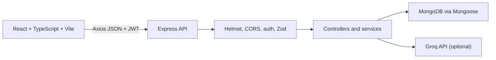

# SpendWise System Design

## Architecture

SpendWise is a modular monolith: the React/Vite browser client calls an
Express/Node.js API, which applies authentication, validation, authorization,
and business rules before reading or writing MongoDB through Mongoose.
The optional Groq integration is called only by the backend with aggregate
financial data.

## Request lifecycle

For example, adding a shared expense follows this path:

1. The group form sends `POST /api/groups/:groupId/expenses`.
2. Express parses JSON, the auth middleware verifies the JWT, and the route
   validates the body with Zod.
3. The controller delegates to `groupService`.
4. The service verifies group membership, calculates integer-paise shares,
   persists the expense, and returns a safe response with display names.
5. The client updates the activity list and asks the balance endpoint for the
   authoritative current balance.

Personal transactions follow the same route/controller/service/model pattern.
Queries always include the authenticated user ID, so a client cannot select
another user's private records.

## Authentication and authorization

Registration and login hash passwords with bcryptjs and return a signed JWT.
The browser stores the token in `localStorage` for this MVP; Axios sends it as
an `Authorization: Bearer` header. Protected routes use the JWT subject as the
trusted user ID. Group routes additionally verify that the user is a member,
and administrative group actions check the embedded member role.

Profile updates are limited to the authenticated user through
`PATCH /api/auth/me`. Password changes use a separate endpoint, verify the
current password, and hash the replacement. Password hashes are never returned.

## Data model

- **User:** name, unique normalized email, and a bcrypt password hash.
- **Transaction:** user-owned income or expense, amount, category, description,
  and date. It powers personal analytics.
- **Budget:** user, category, year/month, and monthly limit. A compound unique
  index prevents duplicate category budgets for a period.
- **Group:** name, type, description, owner, and embedded members with roles.
- **GroupInvitation:** group, inviter, invitee, status, timestamps, and a
  partial unique index preventing duplicate pending invitations.
- **GroupExpense:** group, payer, integer-paise total, participants, stored
  shares, split method, and creator.
- **GroupSettlement:** group, payer, recipient, integer-paise amount, status,
  creator, timestamps, and an idempotency key for retry-safe recording.

## API and financial rules

Important endpoints include:

- `POST /api/auth/register`, `POST /api/auth/login`, `GET/PATCH /api/auth/me`
- `GET/POST /api/transactions` and transaction detail/update/delete routes
- `GET/POST/PATCH/DELETE /api/budgets`
- `GET /api/analytics/monthly`
- `GET/POST /api/groups` and invitation routes
- `GET/POST /api/groups/:groupId/expenses`
- `GET /api/groups/:groupId/expenses/balances/me`
- `GET/POST /api/groups/:groupId/expenses/settlements`

Group expense accounting credits the payer for the full amount and debits
each stored participant share, including the payer's own share. Pairwise
debts are netted, then completed settlements reduce the relevant debt exactly
once. Suggested settlements are a separate simplified plan and are filtered
to the authenticated user in the current-user flow.

## Performance choices

Personal transaction and group expense lists are bounded with pagination.
Independent dashboard, group, budget, and settlement requests are parallelized
with `Promise.all`. MongoDB indexes support user/date transaction queries,
member lookup, group/date expense history, settlement history, budget periods,
and invitation status checks.

The client uses route-level lazy loading so the initial route does not need to
download every group, budget, and transaction screen. The production build
still reports a large optional chart/vendor chunk; this is a warning, not a
failed build.

## Errors and security

Zod validation returns field-level errors, authentication failures return
401, unauthorized group operations return 403, missing resources return 404,
duplicates return 409, and provider/database failures are surfaced without
secrets. Helmet, restricted CORS, server-side authorization, safe projections,
and environment-only credentials are used.

Known limitations are the MVP JWT storage strategy, no refresh-token
revocation, no shared rate limiter, and no browser-level automated tests.
